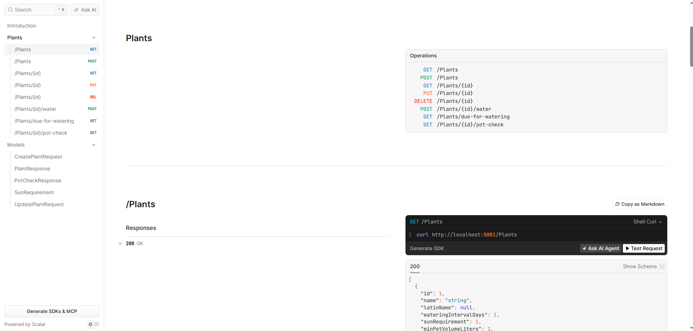

# Plant Organizer

A application for gardeners that tracks plants database and tells you when to water them, when to expect harvest, what pot size a plant need

## Features

- CRUD for plants (name, sun requirements, watering interval, minimum pot size, days to harvest)
- Watering schedule: next watering date and a list of plants due for watering today
- Expected harvest date based on planting date and days to harvest
- Pot check: tells whether a given pot volume is enough for a plant
- Input validation and consistent error responses (ProblemDetails)

## Tech stack

- .NET 10, ASP.NET Core Web API
- Entity Framework Core with SQLite
- xUnit for unit tests (in-memory SQLite, fake clock via `TimeProvider`)
- Scalar for interactive API documentation

## Getting started

```bash
git clone [your repository URL]
cd Plant-Organizer/PlantOrganizer
dotnet ef database update --project src/PlantOrganizer.Api
dotnet run --project src/PlantOrganizer.Api
```

The API runs at `http://localhost:5001`. In development, interactive docs are at
`http://localhost:5001/scalar`.

## Running tests

```bash
dotnet test
```

## API overview

| Method | Endpoint | Description |
|---|---|---|
| GET | `/plants` | List all plants |
| GET | `/plants/{id}` | Get a plant |
| POST | `/plants` | Create a plant |
| PUT | `/plants/{id}` | Update a plant |
| DELETE | `/plants/{id}` | Delete a plant |
| POST | `/plants/{id}/water` | Mark a plant as watered today |
| GET | `/plants/due-for-watering` | Plants that need watering |
| GET | `/plants/{id}/pot-check?volumeLiters=5` | Check if a pot is big enough |


